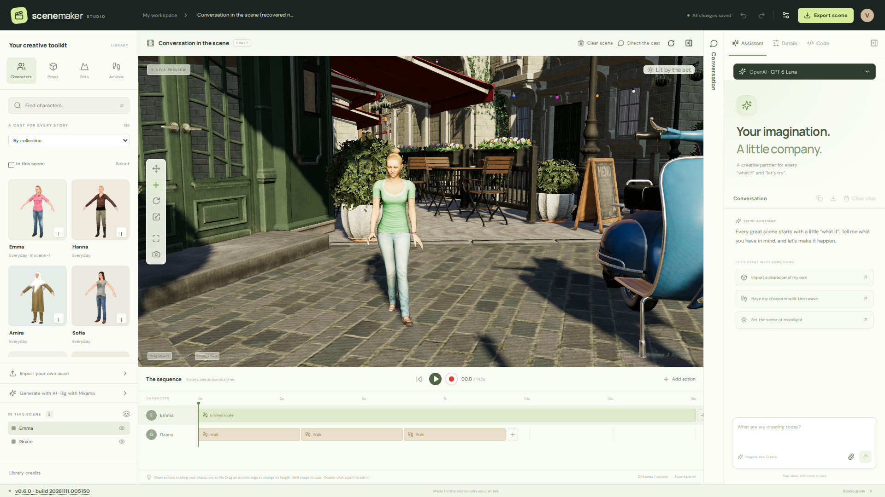
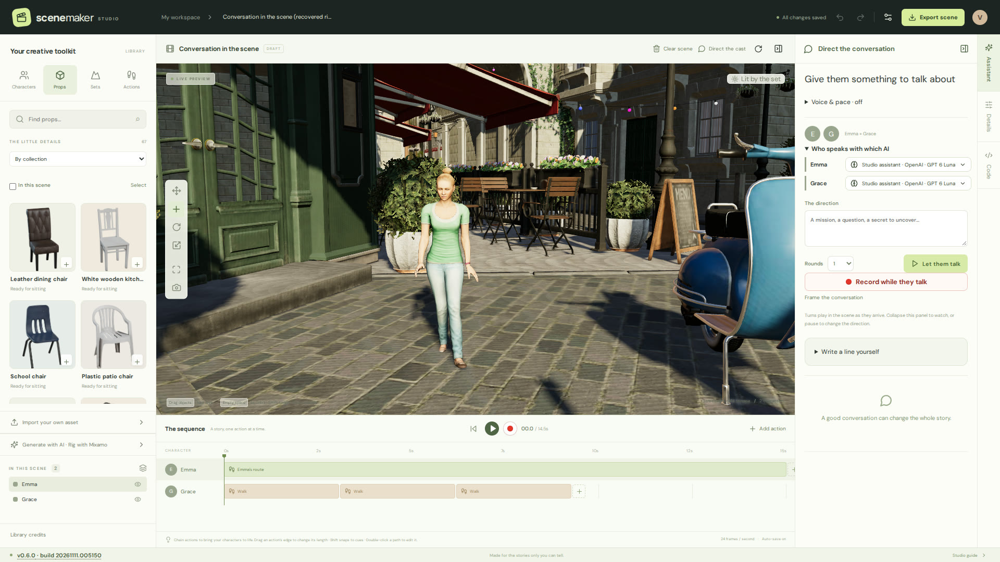
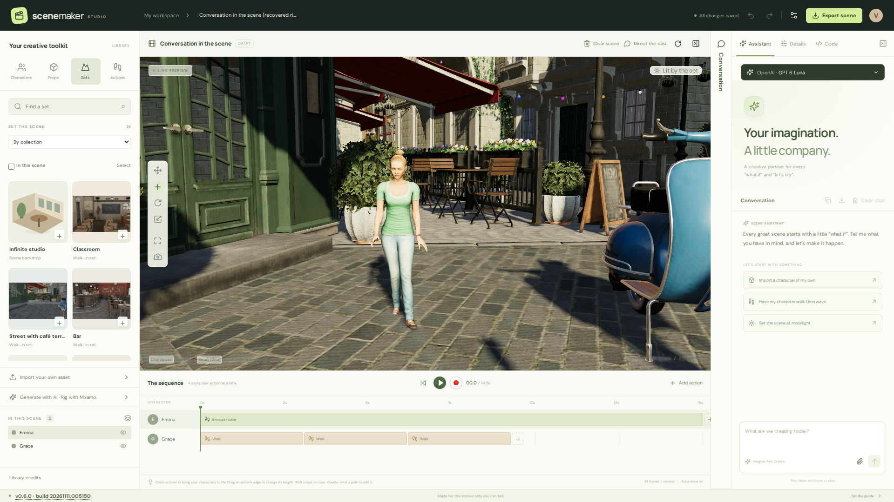
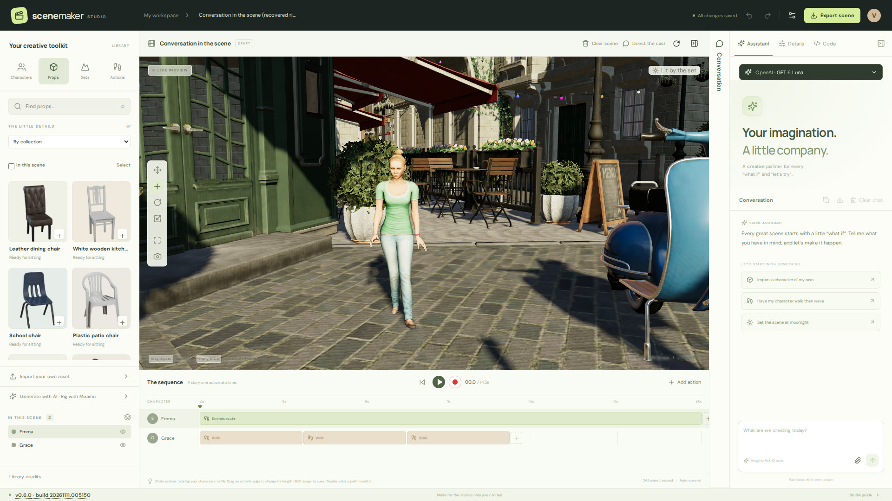
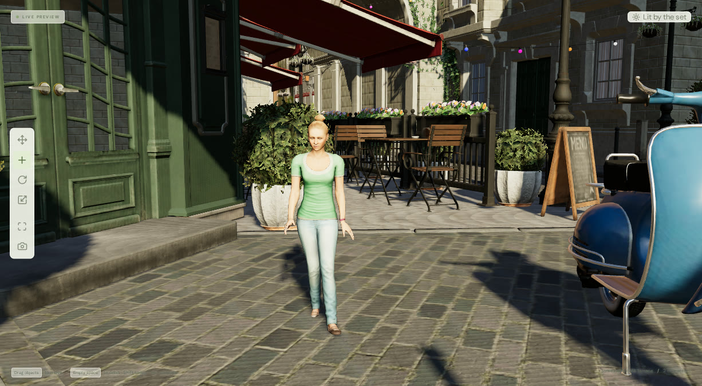

<div align="center">

# 🎬 Scene Maker

**Cast it. Stage it. Tell them what to say. Hit record.**

A local-first 3D studio where realistic characters walk real sets, pick things up, sit down, and hold AI-driven conversations with each other — then export to Blender, Unreal, or a finished MP4.

[](docs/ASTRA_RELEASE_VERIFICATION.md)
[](LICENSE)




</div>

---

## Why it's different

Most 3D tools make you animate. Scene Maker lets you **direct**.

Pick a cast from 120+ realistic characters, drop them into a walk-in set, then say *"Emma walk to the tea cup, pick it up, take a sip and put it down."* The studio plans a route around the furniture, reaches with the character's actual arm length, brings the cup to her mouth, and sets it back where it was. Give the cast a topic and they'll **talk to each other**, each character on whichever AI model you choose, with voices, speech bubbles, gestures and timed subtitles. Every line plays in the scene as it arrives.

Everything runs on your machine. Your projects, keys and assets stay on your disk.

## ✨ Highlights

| | |
|---|---|
| 🧍 **A real cast** | 120+ ready-to-use characters: the complete Microsoft Rocketbox cast, realistic Grab3D characters and Blender Studio's Rain, Snow and Einar. Import your own, including a whole batch of Mixamo downloads at once. |
| 🏙️ **Walk-in sets** | Eight full 3D sets (a classroom, a bar, a café street and more) with measured floors and their own lighting, plus 17 photo backdrops and 60+ realistic props. |
| 🎭 **Chained performances** | 124 motion-captured takes. Chain walk → sit → talk → wave → stand up, with smooth blends between actions, seated performances, ladder climbs, and prop pick-up / sip / put-down with real hand contact. |
| 🗺️ **Routes that avoid obstacles** | Draw a path, or ask for one. Planned routes go around placed objects and stop within arm's reach of the target. |
| 💬 **Direct the cast** | Give the characters a mission and they hold an AI conversation in turn. Assign each one its own provider and model. Voices from your browser, local **Piper** neural voices, OpenAI or ElevenLabs. |
| 🔴 **Record to MP4** | One click records a 1920×1080 take straight from the preview camera, with subtitles and voice audio. You can also record a conversation as it's being generated. |
| 🤖 **Talk to your studio** | The assistant builds scenes, adds and directs the cast, saves, and exports. Works with OpenAI, Anthropic, Google, xAI, Kimi, OpenRouter or a local **LM Studio** model. An offline command helper covers the basics without any key. |
| 🔁 **Production handoff** | Export an animated GLB package, a `.blend` file, or a ready-to-open **Unreal Engine 5.6** project. Characters, props, baked animation and SRT subtitles are included. |
| 🛠️ **It can improve itself** | The **Code** panel runs autonomous coding agents on private Git checkouts of the studio. Describe a feature and it can build, test, push and redeploy the app you're using. |

<table>
<tr>
<td width="50%"><br><sub><b>Direct the cast:</b> each character speaks with its own model.</sub></td>
<td width="50%"><br><sub><b>Walk-in sets:</b> real 3D environments, not painted backdrops.</sub></td>
</tr>
<tr>
<td width="50%"><br><sub><b>Props that work:</b> seats know where to sit, cups know where to be held.</sub></td>
<td width="50%"><br><sub><b>Live preview:</b> scrub, play and record what you see.</sub></td>
</tr>
</table>

## 🚀 Quick start

You need **Node.js 22.12+** and a GPU-capable browser.

```sh
git clone https://github.com/VincentAZ/scene-maker.git
cd scene-maker
./start.sh
```

On Linux, `start.sh` installs dependencies, downloads the character, prop and motion library, builds the app and opens the studio. The first run takes a few minutes. Stop it with `./start.sh --stop`.

<details>
<summary><b>Manual / other platforms</b></summary>

```sh
npm ci
node scripts/build-content.mjs
npm run dev          # http://127.0.0.1:5173
```

Production build:

```sh
npm run build
npm start            # http://127.0.0.1:4311
```

The server binds to loopback only. It's a single-user local studio, not a hosted service.

</details>

<details>
<summary><b>Optional tools</b></summary>

- **Blender 4.5 LTS** builds the walk-in 3D sets in the background (about 2 GB of downloads, needs `unzip`), converts FBX imports and writes `.blend` exports.
- **ffmpeg** produces standard H.264 MP4 recordings (required in Firefox).
- **Piper** gives you 140+ local neural voices in 40+ languages. Install it from *Studio settings → Connections → Voices*.
- **Unreal Engine 5.6+** opens the exported project.

</details>

## 🎬 Your first scene in two minutes

1. **Set:** open **Sets** and pick *Street with café terrace*.
2. **Cast:** drag *Emma* and *Daniel* from **Characters** into the viewport.
3. **Dress:** drag a *Folding café table* and a *Porcelain tea cup* from **Props** onto the street. The cup lands on the tabletop.
4. **Stage:** ask the assistant *"Emma walk to Porcelain tea cup then pick up then sip then put down"*.
5. **Direct:** click **Direct the cast**, type *"Plan a surprise party without the waiter noticing"*, then **Let them talk**.
6. **Shoot:** hit the red **Record** button. You get an MP4.

Connect an AI provider under **Studio settings → Connections**: paste a key, load models, save. Without a key, the offline helper still understands commands like *"Add a coffee cup"*, *"Mila walk then jump"* and *"Set moonlight"*.

## 🧱 How it's built

```
src/        React + TypeScript studio UI, Three.js viewport, timeline, recorder
shared/     Engine-neutral scene schema + command reducer (UI and AI use the same validated path)
server/     Local service: projects, AI providers, voices, imports, exports, coding agents
engine/     Blender & Unreal adapters, asset conversion
scripts/    Content builds and verification tools
tests/      Vitest suites + Blender verification scripts
```

- **One source of truth.** Every edit, whether a mouse drag or an AI plan, goes through the same validated command reducer.
- **Safe by default.** Model-generated code is never executed in the scene pipeline. Keys stay server-side (`.data/connections.json`, mode `0600`). Write requests require a loopback origin.
- **Atomic, conflict-aware saves** with revision checks and a browser recovery copy.
- **Measured, not eyeballed.** Blender scripts check exported scenes for hand-to-cup contact, foot planting, seat contact, route clearance and pose continuity.

```sh
npm test        # 1,600+ automated tests
npm run build
```

## 📚 Docs

- **[User guide](docs/USER_GUIDE.md)** covers every feature in depth: routes, seating, props, imports, voices, recording, exports and the Code panel.
- [0.6.0 release verification and known limitations](docs/ASTRA_RELEASE_VERIFICATION.md)
- [Character assets](docs/CHARACTER_ASSETS.md) · [Motion assets](docs/MOTION_ASSETS.md) · [Furniture assets](docs/FURNITURE_ASSETS.md)
- [Design decisions](docs/DECISIONS.md) · [Verification log](docs/VERIFICATION.md) · [References](docs/REFERENCES.md)

## ⚖️ Honest limits

Scene Maker is a working studio, not a physics engine. Collision checks use conservative bounding boxes. Routes are flat, so there are no stairs or uneven ground. Motion sharing between rigs covers the body, not fingers or faces, and there's no phoneme lip-sync yet. The Unreal export is contract-tested but hasn't been verified inside a live Unreal editor. The [user guide](docs/USER_GUIDE.md#current-scope-limits) lists the details.

## 🙏 Credits & license

The bundled library comes from generous open sources: [Microsoft Rocketbox](https://github.com/microsoft/Microsoft-Rocketbox) (MIT), [Poly Haven](https://polyhaven.com) props and environments (CC0), [Blender Studio](https://studio.blender.org) (CC BY 4.0), [Grab3D](https://grab3d.com) (CC0), NVIDIA's Amazon Lumberyard Bistro and other open scenes, the [CMU Graphics Lab Motion Capture Database](https://mocap.cs.cmu.edu), [100STYLE](https://zenodo.org/records/8127870) (CC BY 4.0), and [Quaternius](https://quaternius.com) / [Kenney](https://kenney.nl) (CC0). Each library folder carries its own licence, and **Studio settings → Credits** lists every source.

Scene Maker's own code is released under the [MIT License](LICENSE). Third-party assets, models and services keep their own terms.

<div align="center"><sub>Made for the stories only you can tell.</sub></div>
